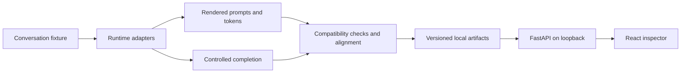

# Architecture

LLM Chat Template Compatibility uses a typed Pydantic domain model shared by the CLI and FastAPI. Runtime adapters capture renderer output, observed token IDs, tokenizer metadata, and controlled completions. The comparison layer aligns token sequences, applies deterministic diagnostic rules, and records uncertainty. The artifact store writes versioned JSON plus Markdown reports. The React inspector reads those stored artifacts through loopback-only API routes.

MLX-LM observations come from the active tokenizer template and `stream_generate`. llama.cpp observations come from `/apply-template`, `/tokenize`, and `/completion`. The controlled completion path sends numeric token IDs directly. Unknown metadata stays unknown; the current llama.cpp `/props` response does not expose vocabulary size, so cross-runtime token compatibility is conservatively unverified.
